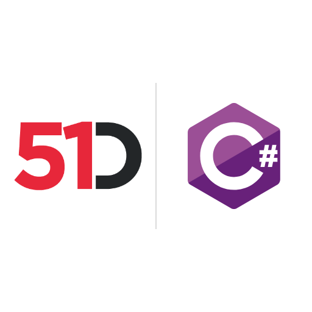

# 51Degrees Device Detection and IP Intelligence for .NET and C#



**.NET packages for the Pipeline API, Device Detection, IP Intelligence and Location**

Our User-Agent parser for .NET and C# supports Device Detection, browser detection, mobile detection, and crawler detection on-premise or in the cloud. IP Intelligence adds IP geolocation, including IP to country data.

It reads User-Agent and User-Agent Client Hints, HTTP request headers that carry browser and device information. For cloud bot detection, Human Confidence reports confidence that a person is viewing the page.

## Install

Each product is a separate NuGet package. For Device Detection and IP Intelligence, cloud or on-premise:

```
dotnet add package FiftyOne.DeviceDetection
dotnet add package FiftyOne.IpIntelligence
```

The product guides below list the other packages. To build from source, see [Getting the code](#getting-the-code).

Try the [User-Agent tester](https://51degrees.com/developers/user-agent-tester?utm_source=github&utm_medium=readme&utm_campaign=51degrees-dotnet&utm_content=readme.md&utm_term=install) and [IP tester](https://51degrees.com/developers/ip-tester?utm_source=github&utm_medium=readme&utm_campaign=51degrees-dotnet&utm_content=readme.md&utm_term=install). For cloud use, [create a Resource Key](https://configure.51degrees.com/?utm_source=github&utm_medium=readme&utm_campaign=51degrees-dotnet&utm_content=readme.md&utm_term=install).

Created from `pipeline-dotnet`, `device-detection-dotnet`, `ip-intelligence-dotnet`, `location-dotnet`, `common-dotnet`, `caching-dotnet`, `device-detection-dotnet-examples`, and `ip-intelligence-dotnet-examples`, this repository continues their work.

| Product | Read first | Documentation |
| --- | --- | --- |
| Pipeline API | [pipeline/README.md](pipeline/README.md) | [Guide](https://51degrees.com/documentation/_pipeline_api__concepts__pipeline_basics.html?utm_source=github&utm_medium=readme&utm_campaign=51degrees-dotnet&utm_content=readme.md&utm_term=pipeline-guide) and [.NET API](https://51degrees.com/documentation/apis/pipeline-dotnet/annotated.html?utm_source=github&utm_medium=readme&utm_campaign=51degrees-dotnet&utm_content=readme.md&utm_term=pipeline-dotnet) |
| Device Detection | [device-detection/README.md](device-detection/README.md) | [Guide](https://51degrees.com/documentation/_device_detection__quickstart.html?utm_source=github&utm_medium=readme&utm_campaign=51degrees-dotnet&utm_content=readme.md&utm_term=device-detection-guide) and [.NET API](https://51degrees.com/documentation/apis/device-detection-dotnet/annotated.html?utm_source=github&utm_medium=readme&utm_campaign=51degrees-dotnet&utm_content=readme.md&utm_term=device-detection-dotnet) |
| IP Intelligence | [ip-intelligence/README.md](ip-intelligence/README.md) | [Guide](https://51degrees.com/documentation/_ip_intelligence__quickstart.html?utm_source=github&utm_medium=readme&utm_campaign=51degrees-dotnet&utm_content=readme.md&utm_term=ip-intelligence-guide) and [.NET API](https://51degrees.com/documentation/apis/ip-intelligence-dotnet/annotated.html?utm_source=github&utm_medium=readme&utm_campaign=51degrees-dotnet&utm_content=readme.md&utm_term=ip-intelligence-dotnet) |
| Location | [location/README.md](location/README.md) | [Guide](https://51degrees.com/documentation/_reverse_geocoding__quickstart.html?utm_source=github&utm_medium=readme&utm_campaign=51degrees-dotnet&utm_content=readme.md&utm_term=location-guide) and [.NET API](https://51degrees.com/documentation/apis/location-dotnet/annotated.html?utm_source=github&utm_medium=readme&utm_campaign=51degrees-dotnet&utm_content=readme.md&utm_term=location-dotnet) |

## What is where

| Path | Contents |
| --- | --- |
| `common` | `FiftyOne.Common`, shared by every 51Degrees .NET product |
| `caching` | `FiftyOne.Caching`, the cache interfaces and the LRU cache |
| `pipeline` | The Pipeline API packages, `FiftyOne.Pipeline.*` and `FiftyOne.Did*` |
| `device-detection` | The Device Detection packages, `FiftyOne.DeviceDetection*` |
| `ip-intelligence` | The IP Intelligence packages, `FiftyOne.IpIntelligence*` |
| `location` | The Location packages, `FiftyOne.Geolocation*` |
| `examples/device-detection`, `examples/ip-intelligence` | The Device Detection and IP Intelligence examples, with their tests |
| `cxx` | Submodule of [51degrees-cxx](https://github.com/51Degrees/51degrees-cxx), with the C and C++ code the on-premise engines build and the data file submodules |
| `FiftyOne.slnx` | A solution holding every project. `FiftyOne.Core.slnf` leaves out the .NET Framework projects for `dotnet build`. Each folder also keeps the solutions it had before |

A project's folder is its package id without the product prefix, so
`pipeline/Core` holds `FiftyOne.Pipeline.Core.csproj` and
`device-detection/Cloud` holds `FiftyOne.DeviceDetection.Cloud.csproj`. The
project file keeps the full name, which is what sets the assembly and package
id. The package named after the product alone keeps the product word, as in
`device-detection/DeviceDetection`.

## Getting the code

```
git clone --recurse-submodules https://github.com/51Degrees/51degrees-dotnet.git
```

If you have already cloned the repository, fetch the submodules with:

```
git submodule update --init --recursive
```

The free data files are not stored in the repository. The
[data](https://github.com/51Degrees/data) repository, the `cxx/data`
submodule, keeps a link for each one in its `device-detection` and
`ip-intelligence` folders, and its scripts download them beside their links.
From the repository root, run `pwsh cxx/data/get-data-files.ps1`, or
`sh cxx/data/get-data-files.sh`, which needs curl and gzip. The examples run
the script themselves when the free file they need is missing.

Nothing here reads the older `cxx/device-detection-data` and
`cxx/ip-intelligence-data` folders. When cxx removes those submodules, git
leaves their folders on disk in an existing clone, and they can be deleted.

## Building

Everything, from the repository root:

```
dotnet build FiftyOne.Core.slnf
```

On Windows with Visual Studio, `msbuild FiftyOne.slnx -restore` builds the
.NET Framework projects as well.

Or one product, for example `dotnet build pipeline/FiftyOne.Pipeline.sln`.

The on-premise engines, `device-detection/Hash.Engine.OnPremise` and
`ip-intelligence/Engine.OnPremise`, compile the C and C++ code in
`cxx` into a native library before the managed build. That needs
[CMake](https://cmake.org/) 3.24 or later, a C++17 compiler and PowerShell 7
on the path, and a platform other than `AnyCPU`, for example:

```
dotnet build device-detection/FiftyOne.DeviceDetection.sln -p:Platform=x64
```

On Windows, Visual Studio 2019 or later, or the C++ Build Tools, with
Platform Toolset `v142` and Windows SDK `10.0.18362.0` or later.

The ASP.NET (.NET Framework) projects, such as `FiftyOne.Pipeline.Web.Framework`
and the `Framework-Web` examples, build with `msbuild` on Windows and are left
out of the `.Core.slnf` solution filters that `dotnet build` uses.

## Package and project references

A project here that uses a package built in another folder of this repository,
for example Device Detection using `FiftyOne.Pipeline.Engines`, declares that
once as a `FiftyOneReference` item, and a property chooses what it becomes:

| `FiftyOneReferences` | The reference | When |
| --- | --- | --- |
| `Package` | A `PackageReference` to the published package, at the version in `Directory.Build.props` | The default, so a checkout builds the way a consumer's project does, and the examples show how the packages are used |
| `Project` | A `ProjectReference` to the project next to it | A change that crosses packages, which is how CI builds and tests the repository |

Choose project references with any of these, the first that is set wins:

```
dotnet build FiftyOne.slnx -p:FiftyOneReferences=Project
```

a `Directory.Build.local.props` file next to this README, which is not
committed:

```xml
<Project>
  <PropertyGroup>
    <FiftyOneReferences>Project</FiftyOneReferences>
  </PropertyGroup>
</Project>
```

or the `FiftyOneReferences` environment variable. `Directory.Build.props` and
`Directory.Build.targets` at the root hold the rule.

## Tests

The tests are MSTest, run with `dotnet test` on a solution, a solution filter
or a project, for example:

```
dotnet test pipeline/FiftyOne.Pipeline.sln
dotnet test device-detection/FiftyOne.DeviceDetection.Core.slnf -p:Platform=x64
```

The on-premise tests find the free data files in `cxx` by searching upward
from the test assembly. Point them at other files, such as the Enterprise
files, with `_51DEGREES_DD_PATH` and `_51DEGREES_IPI_PATH`. The tests that use
the cloud read a Resource Key from `_51DEGREES_RESOURCE_KEY`, and the 51Did
tests a License Key from `_51DEGREES_LICENSE_KEY`. See each folder's README
for the keys and data files its tests use.

Every environment variable name that the packages, tests, examples and CI
scripts read is in [common-ci's list of environment variable names](https://github.com/51Degrees/common-ci/blob/18f9a570ed862a0b7e1ecb1c55a8319f35f02491/environment-variables.md),
which decides.

## Regenerating the SWIG wrappers

The wrappers in each on-premise engine folder are generated from
`hash_csharp.i` and `ipi_csharp.i`, which include the interface files in
`cxx/src`. Configure the native build with `-DRebuildSwig=On` and SWIG 4.2 or
later on the path to generate them again.

## History

| Earlier repository | What it held |
| --- | --- |
| [pipeline-dotnet](https://github.com/51Degrees/pipeline-dotnet) | The Pipeline API |
| [device-detection-dotnet](https://github.com/51Degrees/device-detection-dotnet) | Device Detection |
| [ip-intelligence-dotnet](https://github.com/51Degrees/ip-intelligence-dotnet) | IP Intelligence |
| [location-dotnet](https://github.com/51Degrees/location-dotnet) | Location |
| [common-dotnet](https://github.com/51Degrees/common-dotnet) | Shared code |
| [caching-dotnet](https://github.com/51Degrees/caching-dotnet) | Caching |
| [device-detection-dotnet-examples](https://github.com/51Degrees/device-detection-dotnet-examples) | Device Detection examples |
| [ip-intelligence-dotnet-examples](https://github.com/51Degrees/ip-intelligence-dotnet-examples) | IP Intelligence examples |


The repositories `common-dotnet`, `caching-dotnet`, `pipeline-dotnet`,
`device-detection-dotnet`, `ip-intelligence-dotnet`, `location-dotnet`,
`device-detection-dotnet-examples` and `ip-intelligence-dotnet-examples` were
brought in with `git subtree add`, without `--squash`, so commit SHAs match the
originals. The imported commits keep their original paths, so to trace a file
back through the import ask git to follow renames through merges:

```
git log --follow -m -- pipeline/README.md
```

## License

[European Union Public Licence v1.2](LICENSE)

## Find out more

- [Device Detection](https://51degrees.com/device-detection?utm_source=github&utm_medium=readme&utm_campaign=51degrees-dotnet&utm_content=readme.md&utm_term=find-out-more)
- [IP Intelligence](https://51degrees.com/ip-intelligence?utm_source=github&utm_medium=readme&utm_campaign=51degrees-dotnet&utm_content=readme.md&utm_term=find-out-more)
- [Bots and humans](https://51degrees.com/bots-and-humans?utm_source=github&utm_medium=readme&utm_campaign=51degrees-dotnet&utm_content=readme.md&utm_term=find-out-more)
- [Documentation](https://51degrees.com/documentation/index.html?utm_source=github&utm_medium=readme&utm_campaign=51degrees-dotnet&utm_content=readme.md&utm_term=find-out-more)
- https://github.com/51Degrees/51degrees-cxx
