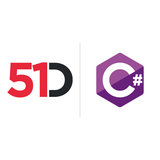

# 51Degrees IP Intelligence Engines

 **Pipeline API**

[Developer Documentation](https://51degrees.com/documentation/_ip_intelligence__quickstart.html?utm_source=nuget&utm_medium=package&utm_campaign=51degrees-dotnet&utm_content=fiftyone.ipintelligence&utm_term=51degrees-ip-intelligence-engines "developer documentation")

## Introduction

This repository contains the IP intelligence engines for the .NET implementation of the Pipeline API.

The
[specification](https://github.com/51Degrees/specifications/blob/main/ip-intelligence-specification/README.md)
is also available on GitHub and is recommended reading if you wish to understand
the concepts and design of this API.

## Dependencies

Visual Studio 2019 or later is recommended. Although Visual Studio Code can be used for working with most of the projects.

The core IP intelligence projects are written in C and C++.
The Pipeline engines are written in C# and target .NET Standard 2.0. Example and test
projects mostly target .NET 8.0 though in some cases, projects are available
targeting other frameworks.

For the .NET versions we test against, see the
[tested versions](https://51degrees.com/documentation/_product_summaries__tested_versions.html?utm_source=nuget&utm_medium=package&utm_campaign=51degrees-dotnet&utm_content=fiftyone.ipintelligence&utm_term=dependencies)
page. The `ci/options.json` file lists the tested and packaged .NET versions
and operating systems automatic tests are performed with. The solution will
likely operate with other versions.

### Data

The API does detections using a local (on-premise) data file or cloud service (coming soon).

#### On-Premise

In order to perform IP intelligence on-premise, you will need to use a
data file.

The scripts in the [data](https://github.com/51Degrees/data) repository, which is the `cxx/data` submodule, download the free 'Lite' data file, for example with `pwsh cxx/data/get-data-files.ps1 51Degrees-LiteV41.ipi` from the repository root. Otherwise [contact us](https://51degrees.com/contact-us?utm_source=github&utm_medium=readme&utm_campaign=51degrees-dotnet&utm_content=readme.md&utm_term=on-premise) to obtain an 'Enterprise' data file.

Tests that need a data file locate it in the following order:

1. The "_51DEGREES_IPI_PATH" environment variable, which can be set to an
   explicit path to the data file.
2. A search of the folder hierarchy, walking up from the working directory,
   for the expected data file name.
3. The free 'Lite' data file in its expected location, which is
   `cxx/data/ip-intelligence`.

#### Cloud (coming soon)

You will require [resource keys](https://51degrees.com/documentation/_services__cloud__resource_keys.html?utm_source=nuget&utm_medium=package&utm_campaign=51degrees-dotnet&utm_content=fiftyone.ipintelligence&utm_term=cloud-coming-soon)
to use the Cloud API, as described on our website. Get resource keys from
our [configuration page](https://51degrees.com/configure/?utm_source=nuget&utm_medium=package&utm_campaign=51degrees-dotnet&utm_content=fiftyone.ipintelligence&utm_term=cloud-coming-soon), see our [documentation](https://51degrees.com/documentation/_services__configurator.html?utm_source=nuget&utm_medium=package&utm_campaign=51degrees-dotnet&utm_content=fiftyone.ipintelligence&utm_term=cloud-coming-soon) on
how to use this.

The cloud property tiers changed in May 2026. Of the IP intelligence
properties the examples display, the free tier includes only Country,
LocationConfidence, Ip and IpV6, with a paid subscription needed for the
rest, such as CountryCode, Region, Town, RegisteredName, Latitude and
Longitude. A resource key selecting only the free tier properties can be
[created here](https://51degrees.com/configure/Wkqxf3Bs?utm_source=nuget&utm_medium=package&utm_campaign=51degrees-dotnet&utm_content=fiftyone.ipintelligence&utm_term=cloud-coming-soon), whilst
[this configuration](https://51degrees.com/configure/hYzn3TV3?utm_source=nuget&utm_medium=package&utm_campaign=51degrees-dotnet&utm_content=fiftyone.ipintelligence&utm_term=cloud-coming-soon) also includes the paid properties
used by the examples. See our [pricing page](https://51degrees.com/pricing?utm_source=nuget&utm_medium=package&utm_campaign=51degrees-dotnet&utm_content=fiftyone.ipintelligence&utm_term=cloud-coming-soon) to get a paid
subscription with more properties.

Examples and tests read the resource key from an environment variable called
"_51DEGREES_RESOURCE_KEY".

## Solutions and projects

- **FiftyOne.IpIntelligence** - Ip intelligence engines and related projects.
  - **FiftyOne.IpIntelligence.Engine.OnPremise** - .NET implementation of the IP intelligence on-premise engine.
  - **FiftyOne.IpIntelligence.Shared** - Shared classes used by the IP intelligence engines.
  - **FiftyOne.IpIntelligence** - Contains IP intelligence engine builders.
  - **FiftyOne.IpIntelligence.Cloud** - A .NET engine which retrieves IP intelligence results by consuming the 51Degrees Cloud service. This can be swapped out with either the on-premise engine seamlessly.

## Installation

### Nuget

The easiest way to install is to use NuGet to add the reference to the package:

```pwsh
Install-Package FiftyOne.IpIntelligence
```

### Build from Source

IP Intelligence on-premise uses a native binary (i.e. compiled from C code to
target a specific platform/architecture). The NuGet package contains several
binaries for common platforms. However, in some cases, you'll need to build the
native binaries yourself for your target platform. This section explains how to
do this.

#### Pre-requisites

- Install C build tools:
  - Windows:
    - You will need either Visual Studio 2022 or the [C++ Build Tools](https://visualstudio.microsoft.com/visual-cpp-build-tools/) installed.
      - Minimum platform toolset version is `v143`
      - Minimum Windows SDK version is `10.0.18362.0`
    - Linux/MacOS:
      - `sudo apt-get install g++ make libatomic1`
- If you have not already done so, pull the git submodules that contain the
    native code:
  - `git submodule update --init --recursive`

Visual studio should now be able to build the native binaries as part of its
normal build process.

#### Packaging

You can package a project into NuGet `*.nupkg` file by running a command like:

```sh
dotnet pack [Project] -o "[PackagesFolder]" /p:PackageVersion=0.0.0 -c [Configuration] /p:Platform=[Architecture]
```

##### ⚠️ Notes on packaging `FiftyOne.IpIntelligence.Engine.OnPremise`

📝 Using `AnyCPU` might prevent the unmanaged (C++) code from being built into `.Native.dll` library. Use `x64`/`arm64` specifically.

📝 If creating cross-platform package from multiple native dlls, put all 4x `FiftyOne.IpIntelligence.Engine.OnPremise.Native.dll` into respective folders:

```text
../
    macos/
        arm64/
        x64/
    linux/
        x64/
    windows/
        x64/
```

and add to the packaging command:

```text
/p:BuiltOnCI=true
```

related CI scripts:

- `BuiltOnCI` var:
  - [https://github.com/51Degrees/common-ci/blob/main/dotnet/build-project-core.ps1]
  - [https://github.com/51Degrees/common-ci/blob/main/dotnet/build-package-nuget.ps1]
  - [https://github.com/51Degrees/common-ci/blob/main/dotnet/build-project-framework.ps1]
  - [https://github.com/51Degrees/51degrees-dotnet/blob/main/ci/run-performance-tests.ps1]
- Copying native binaries:
  - [https://github.com/51Degrees/51degrees-dotnet/blob/main/ci/build-package.ps1]

#### Strong naming

We currently do not [strong name](https://learn.microsoft.com/en-us/dotnet/standard/library-guidance/strong-naming#create-strong-named-net-libraries) assemblies due to downsides for developers. The main of which is that .NET Framework on Windows enables strict loading of assemblies once an assembly is strong named. A strong-named assembly reference must exactly match the version of the loaded assembly, forcing developers to configure binding redirects when using the assembly.

If it is absolutely critical for your use case to integrate a strong-named assembly - please create a feature request [issue](https://github.com/51Degrees/51degrees-dotnet/issues/new).

## Examples

Examples can be found in
[ip-intelligence-dotnet-examples](https://github.com/51Degrees/51degrees-dotnet/tree/main/examples/ip-intelligence)
repository.

## Tests

Tests can be found in the `Tests/` folder. These can all be run from within
Visual Studio or by using the `dotnet test` command line tool.

Some tests require additional resources to run. These will either fail or return
an 'inconclusive' result if these resources are not provided.

- Some tests require an 'Enterprise' data file. This can be obtained by [purchasing a license](https://51degrees.com/pricing?utm_source=nuget&utm_medium=package&utm_campaign=51degrees-dotnet&utm_content=fiftyone.ipintelligence&utm_term=tests).
- Tests using the Cloud service require resource keys with specific properties. A [license](https://51degrees.com/pricing?utm_source=nuget&utm_medium=package&utm_campaign=51degrees-dotnet&utm_content=fiftyone.ipintelligence&utm_term=tests-2) is required in order to access some properties.

## Project documentation

For complete documentation on the Pipeline API and associated engines, see the
[51Degrees documentation site](https://51degrees.com/documentation/index.html?utm_source=nuget&utm_medium=package&utm_campaign=51degrees-dotnet&utm_content=fiftyone.ipintelligence&utm_term=project-documentation).

## Find out more

- [IP Intelligence](https://51degrees.com/ip-intelligence?utm_source=nuget&utm_medium=package&utm_campaign=51degrees-dotnet&utm_content=fiftyone.ipintelligence&utm_term=find-out-more-ip-intelligence)
- [IP Intelligence documentation](https://51degrees.com/documentation/_ip_intelligence__quickstart.html?utm_source=nuget&utm_medium=package&utm_campaign=51degrees-dotnet&utm_content=fiftyone.ipintelligence&utm_term=find-out-more-documentation)
- [Getting started](https://51degrees.com/documentation/_ip_intelligence__quickstart.html?utm_source=nuget&utm_medium=package&utm_campaign=51degrees-dotnet&utm_content=fiftyone.ipintelligence&utm_term=find-out-more-getting-started)
- [Pricing](https://51degrees.com/pricing?utm_source=nuget&utm_medium=package&utm_campaign=51degrees-dotnet&utm_content=fiftyone.ipintelligence&utm_term=find-out-more-pricing)
- https://github.com/51Degrees/51degrees-dotnet
- https://github.com/51Degrees/51degrees-cxx
