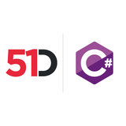

# 51Degrees Geo-Location Engines

 **Pipeline API**

[Developer Documentation](https://51degrees.com/documentation/_reverse_geocoding__index.html?utm_source=nuget&utm_medium=package&utm_campaign=51degrees-dotnet&utm_content=fiftyone.geolocation&utm_term=51degrees-geo-location-engines "developer documentation")
## Introduction

This repository contains engines for the .NET implementation of the Pipeline API 
that provide location services.
Currently, [reverse geocoding](https://en.wikipedia.org/wiki/Reverse_geocoding) 
is supported through the 51Degrees cloud service.

## Dependencies

Visual Studio 2019 or later is recommended. Although Visual Studio Code can be used for working with most of the projects.

The Pipeline engines are written in C# and target .NET Standard 2.0.3.

The [tested versions](https://51degrees.com/documentation/_product_summaries__tested_versions.html?utm_source=nuget&utm_medium=package&utm_campaign=51degrees-dotnet&utm_content=fiftyone.geolocation&utm_term=dependencies) page shows 
the .NET versions that we currently test against. The software may run fine against other versions, 
but additional caution should be applied.

## Solutions and projects

- **FiftyOne.GeoLocation** - Geo-location engines and related projects.
  - **FiftyOne.GeoLocation.Core** - Shared classes used by all geo-location engines.
  - **FiftyOne.GeoLocation** - Contains the geo-location pipeline builders.
  - **FiftyOne.GeoLocation.Cloud** - A .NET engine which uses the 51Degrees cloud service to perform reverse geocoding.
  
## Installation

You can either reference the projects in this repository or you can reference the [NuGet][nuget] packages in your project:

```
Install-Package FiftyOne.GeoLocation
```

## Examples

Examples can be found in the `GeoLocation/Examples/` folder. See below for a list of examples.

|Example|Description|
|-------|-----------|
|GettingStarted|This example uses the 51Degrees cloud to determine the country from a longitude and latitude.|
|CombiningServices|This example uses geo-location alongside device detection to determine the country and device.|

## Tests

Tests can be found in the `Tests/` folder. These can all be run from within Visual Studio or 
with the `dotnet test` command.

## Project documentation

For complete documentation on the Pipeline API and associated engines, see the [51Degrees documentation site][Documentation].

[Documentation]: https://51degrees.com/documentation/index.html?utm_source=nuget&utm_medium=package&utm_campaign=51degrees-dotnet&utm_content=fiftyone.geolocation&utm_term=project-documentation
[nuget]: https://www.nuget.org/packages/FiftyOne.GeoLocation/

## Find out more

- [Geolocation](https://51degrees.com/geolocation?utm_source=nuget&utm_medium=package&utm_campaign=51degrees-dotnet&utm_content=fiftyone.geolocation&utm_term=find-out-more-geolocation)
- [Reverse geocoding documentation](https://51degrees.com/documentation/_reverse_geocoding__index.html?utm_source=nuget&utm_medium=package&utm_campaign=51degrees-dotnet&utm_content=fiftyone.geolocation&utm_term=find-out-more-documentation)
- [Getting started](https://51degrees.com/documentation/_reverse_geocoding__quickstart.html?utm_source=nuget&utm_medium=package&utm_campaign=51degrees-dotnet&utm_content=fiftyone.geolocation&utm_term=find-out-more-getting-started)
- [Pricing](https://51degrees.com/pricing?utm_source=nuget&utm_medium=package&utm_campaign=51degrees-dotnet&utm_content=fiftyone.geolocation&utm_term=find-out-more-pricing)
- https://github.com/51Degrees/51degrees-dotnet
